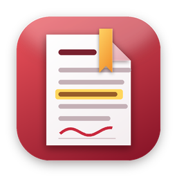

# PaperHawk

A free PDF viewer and editor for Windows from **Bytehawk Studio**, part of the Hawk suite. It does the job of Adobe Acrobat: read PDFs with thumbnails, bookmarks and comments, and (coming soon) edit, fill in, sign, combine, convert and protect them. It uses Bytehawk's Hawkline look (the same left sidebar as Guardrail EHS, WillowWallet, NoteHawk and PlanHawk).

> **Preview (0.1.0):** this is the shell. Six sample documents open in the viewer and on every screen. Opening your own PDFs, editing, signing and the other tools are marked **coming soon**.

## What works in the preview

- **Viewer:** a toolbar on top, page thumbnails and bookmarks on the left, comments and document properties on the right, and floating controls for pages and zoom. Page through with the buttons, Page Up/Page Down, Home/End or by typing a page number. Zoom from 25% to 400%, fit width (Ctrl+2), fit page (Ctrl+0) or actual size (Ctrl+1), also with Ctrl+mouse wheel. Show one page or two side by side, rotate the view, and drag the page around with the hand tool (H).
- **Comments:** highlights and sticky notes on the pages, with authors, dates and replies in the comments panel. Click one on the page or in the panel to jump to it.
- **Banners** for documents that need something from you: a signature, a form to fill in or a scan to recognize.
- **Files:** every document with filters (opened this week, starred, shared, waiting for signature, forms, scans). Click one to read it.
- **All tools:** every planned tool, grouped like Acrobat's tool center. Each one opens its section with the features planned for it.
- **Home:** documents to continue reading where you left off, things waiting for you, recent comments and tools.
- Light and dark mode. Pages stay white like paper in both.

## Planned

- Open, save and print your own PDFs; make PaperHawk the default PDF app
- Find in document, select and copy text
- Add comments, highlights, drawings, text boxes and stamps
- Fill & Sign, request e-signatures and certificate signatures
- Edit text and pictures, organize pages, combine files
- Create PDFs from files and scans; export to Word, Excel, PowerPoint and pictures (and the Hawk suite apps)
- Protect with passwords, redact, compress
- Scan & OCR, accessibility check, read aloud

## Run it

- **Installer:** `PaperHawk-<version>-Setup.exe` from Releases (or through the Bytehawk Studio Launcher).
- **From source:** install the [.NET 8 SDK](https://dotnet.microsoft.com/download/dotnet/8.0), then double-click `run.bat`.
- **Build the exe, zip and installer:** `.\build.ps1` (needs Inno Setup 6: `winget install JRSoftware.InnoSetup`).

## Project layout

| Path | What |
|---|---|
| `src/PaperHawk.Desktop` | WPF (.NET 8) app |
| `src/PaperHawk.Desktop/Models/SampleDocs.cs` | the sample documents, described as blocks (headings, tables, form fields…) with their comments |
| `src/PaperHawk.Desktop/Models/ModuleCatalog.cs` | every sidebar section and its planned features |
| `src/PaperHawk.Desktop/Views/ViewerView.cs` | the PDF viewer |
| `src/PaperHawk.Desktop/Views/PageRenderer.cs` | draws a sample page as a sheet of paper |
| `tools/make_icon.py` | draws the app icon |
| `tools/make_icon_font.py` | builds the icon font from Fluent UI System Icons (MIT) |
| `installer/PaperHawk.iss` | Inno Setup installer |

Releasing: bump `<Version>` in the .csproj and push to `main`; CI builds, self-tests, test-installs and publishes the GitHub Release.

© 2026 Bytehawk Studio. MIT License.
